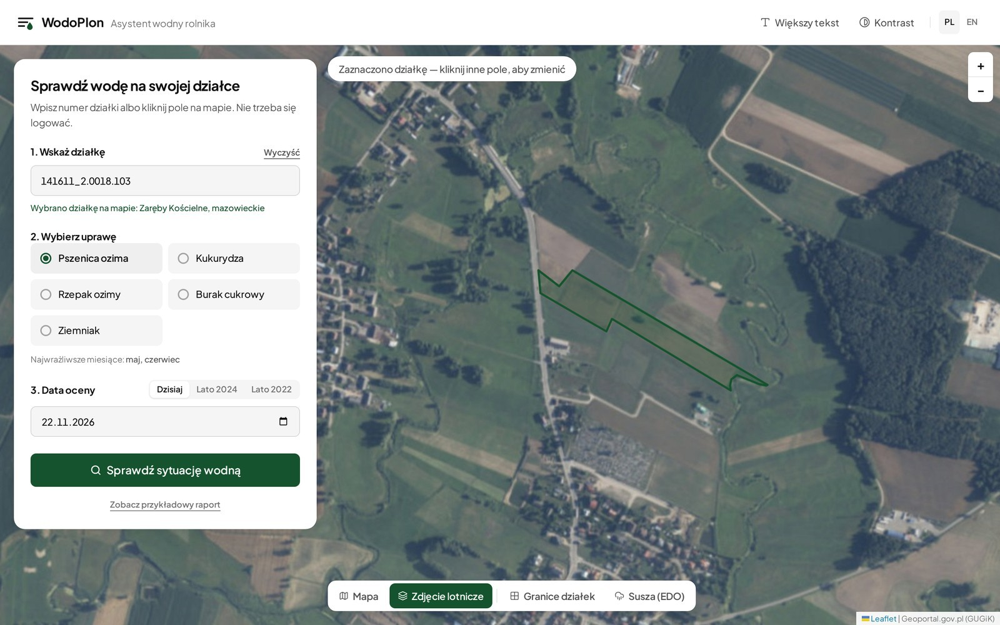
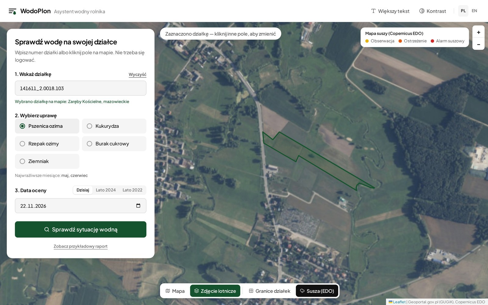
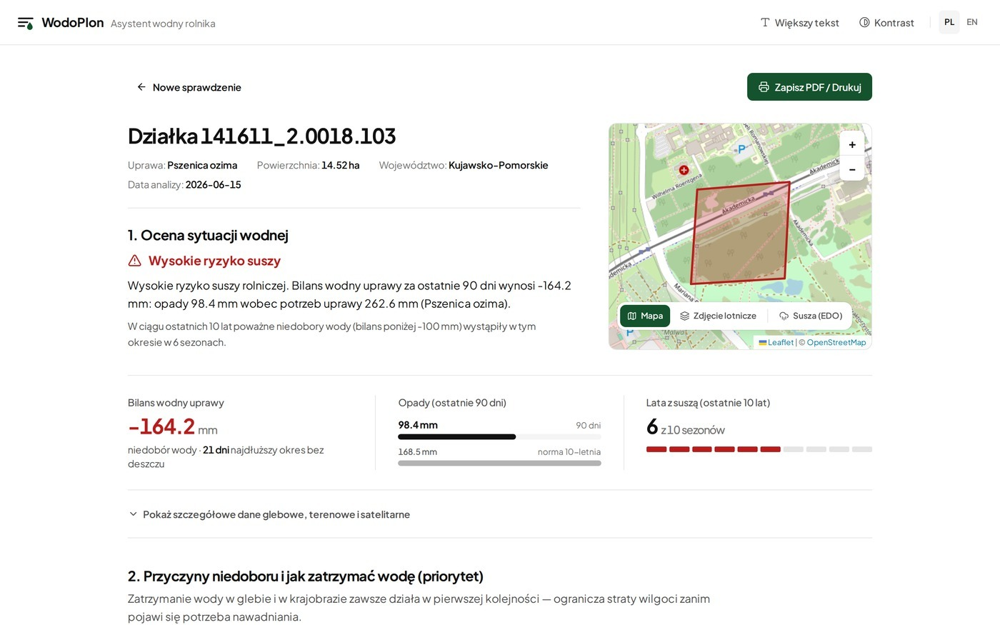
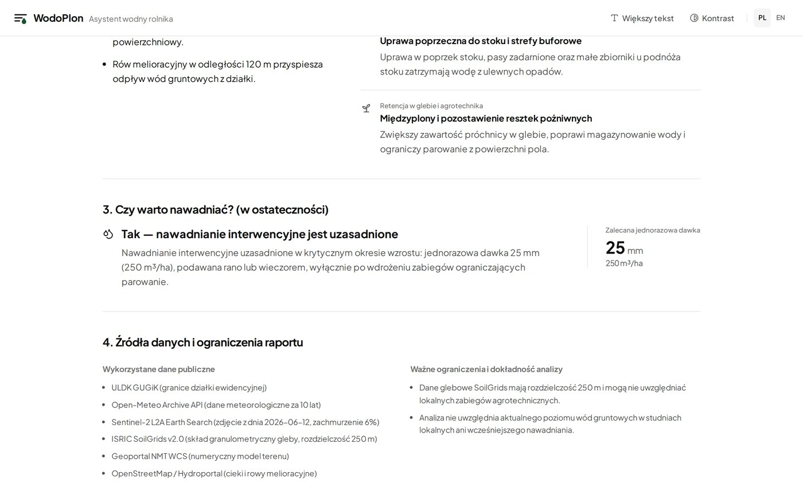

<h1 align="center">
  <picture>
    <source media="(prefers-color-scheme: dark)" srcset="docs/assets/logo-dark.svg">
    
  </picture>
</h1>

WodoPlon is a web app that helps Polish farmers understand the water situation on a specific field and decide what
to do about it. You pick a parcel, a crop and a date. The app pulls open weather, satellite, soil, terrain and
hydrography data for that exact parcel and turns it into a short report in Polish or English.

It runs without accounts, API keys or paid services, and there is no LLM involved at runtime: every number and
recommendation comes from a deterministic engine built on the FAO-56 crop water model.

The project started at HackNation 2026 for the KOWR challenge "Zatrzymaj wodę, chroń plony" (keep the water, protect
the crops).

## Demo

[](https://youtu.be/_8m3ALKiHTU)

A short promo video is on [YouTube](https://youtu.be/_8m3ALKiHTU) and the slides from the hackathon pitch are in
[docs/presentation-pl.pdf](docs/presentation-pl.pdf). Both are in Polish.

The screenshots below show the English interface (the app opens in Polish, with a PL/EN switch in the header).

| Selecting a parcel on the orthophoto | Copernicus EDO drought layer |
|---|---|
|  |  |

| Report: water situation | Report: irrigation and data sources |
|---|---|
|  |  |

## Contents

- [What the report contains](#what-the-report-contains)
- [Quick start](#quick-start)
- [How it works](#how-it-works)
- [API](#api)
- [Development](#development)
- [Production deployment](#production-deployment)
- [Troubleshooting](#troubleshooting)
- [Data sources](#data-sources)
- [Limitations](#limitations)
- [Documentation](#documentation)
- [License](#license)

## What the report contains

A parcel can be selected by its cadastral (TERYT) ID, for example `141611_2.0018.103`, or by clicking on the map.
The boundary comes from the national ULDK service, and the app warns you if the plot is registered as built-up land,
forest, road or water. Five crops are supported (winter wheat, maize, winter rapeseed, sugar beet, potato), and the
analysis date can be anything from today back to ten years ago.

The report always follows the same four steps:

1. **Water situation.** The 90-day water balance (`P − Kc·ET₀`) compared with the median of the same window over the
   previous ten years at this parcel, rainfall against the norm, the longest dry spell, how often drought occurred,
   Sentinel-2 NDVI/NDWI, plus soil, slope and distance to water. A confidence indicator shows how complete the input
   data was.
2. **Causes and retention measures.** Landscape measures come first (weirs on ditches, contour tillage, buffer
   strips), then soil measures (mulching, crop residues, cover crops, reduced tillage). Each one is tied to a
   specific finding for the parcel.
3. **Irrigation, as a last resort.** Suggested only at `HIGH` or `CRITICAL` risk during the crop's critical months
   (or, in the growing season, when NDWI is below −0.15), with a dose of 15–35 mm (150–350 m³/ha).
4. **Sources and limitations.** Every data source with dates, satellite scene dates and cloud cover. Data that could
   not be fetched is reported as missing rather than estimated.

Outside the growing season (November–March) crops take up no water, so the risk level is capped at moderate and the
report explains that it describes the soil water reserve before spring rather than plant stress.

Reports get a permanent link (`/report/{reportUuid}`) and can be printed or saved as PDF. The map offers OSM,
Geoportal orthophoto, cadastral boundaries, the Copernicus EDO drought index, nearby ditches and fields, and runoff
direction on slopes. The UI works on phones and has a high-contrast theme.

## Quick start

You need Docker with Compose v2. The first build takes a few minutes.

```bash
git clone https://github.com/nikwaeis/HackNation2026.git
cd HackNation2026

# Create .env and enable seeding of the crop list
sed 's/DATABASE_RUNSEED=false/DATABASE_RUNSEED=true/' .env.example > .env

docker compose -f docker-compose.dev.yml up -d --build

# Wait until this returns {"status":"ok"}
curl http://localhost:5254/api/health
```

On Windows without a POSIX shell, copy `.env.example` to `.env` and change `DATABASE_RUNSEED` to `true` by hand.
Without it the crop list stays empty.

Open http://localhost:5173. To try it, enter parcel `041509_2.0004.437/3`, choose winter wheat (*Pszenica ozima*),
set the date to `2026-06-15` and run the analysis. The first analysis of a parcel takes 10–20 seconds because the
data is fetched live from several services. After that it is cached and comes back in under a second.

### The water network import

Distance to the nearest river, ditch or lake, and the ditches drawn on the map, come from a local copy of the OSM
water network for Poland. `docker compose up` starts the `osm-import` service, which downloads about 2.1 GB on the
first run, imports it in around ten minutes and exits. Later starts skip it until the data is 30 days old. The app
works in the meantime: the API falls back to the public Overpass API, which is often slow, and a report may say that
water data is still loading.

```bash
docker compose -f docker-compose.dev.yml logs -f osm-import                       # follow the import
docker compose -f docker-compose.dev.yml run --rm -e OSM_IMPORT=always osm-import  # refresh now
```

On a slow or metered connection set `OSM_IMPORT=off` in `.env` to skip it.

### Requirements

| | |
|---|---|
| Docker | Docker Desktop or Docker Engine with Compose v2 |
| Disk | About 6 GB: images ~2 GB, OSM extract 2.1 GB, database ~0.7 GB after the import |
| Network | Outbound HTTPS to the public data services. Open-Meteo and Overpass rate-limit per IP, so a shared network can run out of quota. |
| Optional | .NET 10 SDK, Python 3.11 and Node.js 22, only for running tests or services outside Docker |

### Local URLs

| Service | URL |
|---|---|
| Web app | http://localhost:5173 |
| API health | http://localhost:5254/api/health |
| OpenAPI spec | http://localhost:5254/openapi/v1.json |
| Geo-worker health | http://localhost:8000/health |

Ports can be changed in `.env` with `API_PORT`, `FRONTEND_PORT`, `POSTGRES_PORT`, `REDIS_PORT` and
`PYTHON_SERVICE_PORT`.

## How it works

```
React + Leaflet ──/api───► ASP.NET Core API ──► PostgreSQL 17 + PostGIS 3.5
                ──/uldk──►                  ──► Redis 7
                                            ──► Python geo-worker (terrain, Sentinel-2)
                                            ──► ULDK, Open-Meteo, SoilGrids, Overpass
```

| Component | Path | Stack | Responsibility |
|---|---|---|---|
| Frontend | `src/frontend/` | React 19, TypeScript, Vite, Tailwind CSS 4, Leaflet | Map, parcel lookup, report view, sharing, printing, PL/EN |
| API | `src/backend/` | .NET 10 minimal API, EF Core, NetTopologySuite | Orchestration, caching, request coalescing, analysis engine, reports |
| Geo-worker | `src/python-service/` | Python 3.11, FastAPI, rasterio, shapely, pyproj | Slope from the GUGiK elevation model, NDVI/NDWI from Sentinel-2 |
| OSM importer | `scripts/import-osm-water.sh` | GDAL `ogr2ogr` | Loads about 1.3 million Polish water features into PostGIS on `docker compose up` |
| Database | | PostgreSQL 17 + PostGIS 3.5 | Crops, hydrography, parcel profiles, observations, saved reports |
| Cache | | Redis 7 | Rate limiting and HybridCache |

An analysis runs in four stages:

1. **Static parcel profile.** Boundary, soil and available water capacity, nearest water and slope. Computed once
   per parcel and cached.
2. **Dynamic observation** for each parcel and date: ten years of daily weather for the same 90-day window and the
   most recent cloud-free Sentinel-2 scene, fetched in parallel. If several requests for the same parcel arrive at
   once, they share a single fetch.
3. **Assessment.** The engine compares the current balance with the parcel's own ten-year median, then adjusts the
   result for dry spells, NDWI, sandy soil and drought history. The outcome is one of four levels: `LOW`,
   `MODERATE`, `HIGH`, `CRITICAL`. A balance at or above zero is always `LOW`, and outside the growing season the
   level stops at `MODERATE`.
4. **Report.** Text is rendered from Polish and English templates, with sources and limitations attached.

Ditches and streams on the map also come from the API, out of the local OSM import. Fields that can be picked on the
map are loaded by the browser from the public Overpass API.

If an optional source fails, the analysis still completes. For example, if the geo-worker is down, the satellite
status is reported as `ERROR`. If SoilGrids is unavailable, medium-loam defaults are used. Either way, the report
says so.

## API

| Method | Endpoint | Description |
|---|---|---|
| `GET` | `/api/health` | Health check |
| `GET` | `/api/crops` | Supported crops with their FAO-56 coefficients |
| `POST` | `/api/analyze` | Run an analysis. Body: `dzialkaId` or `lat` + `lon`, plus `cropId` and `targetDate` |
| `GET` | `/api/reports/{reportUuid}` | Fetch a saved report |
| `GET` | `/api/map/context` | Ditches and streams for a map area from the OSM import: `south`, `west`, `north`, `east` in degrees |

Crop IDs are `winter_wheat`, `maize`, `rapeseed`, `sugar_beet` and `potato`. Send `Accept-Language: en` to get the
report in English (Polish is the default).

```bash
curl -X POST http://localhost:5254/api/analyze \
  -H "Content-Type: application/json" \
  -d '{"dzialkaId":"041509_2.0004.437/3","cropId":"winter_wheat","targetDate":"2026-06-15"}'

# By coordinates, with English text
curl -X POST http://localhost:5254/api/analyze \
  -H "Content-Type: application/json" -H "Accept-Language: en" \
  -d '{"lat":53.0605,"lon":18.4410,"cropId":"winter_wheat","targetDate":"2026-06-15"}'
```

`POST /api/analyze` is limited to 10 requests per minute per client and 30 per minute per IP. Over the limit it
returns `429` with a `Retry-After` header. Invalid requests don't count towards the limit.

Some fields in the response can be `null`. That means the data was not available, and step 4 of the report explains
why. The full request and response schema is in [docs/api.md](docs/api.md).

## Development

In the dev compose setup, source folders are mounted into the containers, so the API, frontend and geo-worker reload
on changes (they poll for file changes, which also works on Windows and macOS). The frontend container reinstalls its
packages by itself when `package-lock.json` changes.

```bash
docker compose -f docker-compose.dev.yml logs -f api   # follow API logs
docker compose -f docker-compose.dev.yml down          # stop everything
docker compose -f docker-compose.dev.yml down -v       # stop and delete the database and the OSM download
```

To work on the frontend alone:

```bash
cd src/frontend
npm install
npm run dev
```

The dev server proxies `/api` to `http://localhost:5254`. You can point it elsewhere with `VITE_API_PROXY_TARGET`.
When no backend is reachable, the "Zobacz przykładowy raport" button opens a demo report that is clearly marked as
such, and the map asks the public Overpass API for ditches as well as fields.

### Tests

```bash
dotnet test src/backend/WodoPlon.slnx                                    # API and engine (xUnit)
cd src/python-service && pip install -r requirements-dev.txt && pytest   # geo-worker, no network needed
cd src/frontend && npm ci && npm test && npm run build                   # frontend unit tests (Vitest), type check, build
cd src/frontend && npm run test:e2e                                      # end-to-end (Playwright)
```

The backend tests cover the water-balance math, risk thresholds, retention and irrigation rules, request coalescing,
localized texts and behaviour when upstream services fail. Python tests cover the geo-worker contract, slope
calculation, cloud masking and NDVI/NDWI. The Playwright suite uses the live ULDK and GUGiK services with a stubbed
`/api`. Set `E2E_ALL_BROWSERS=1` to run it in Firefox and WebKit as well.

GitHub Actions ([ci.yml](.github/workflows/ci.yml)) runs the backend, geo-worker and frontend unit tests and the
frontend build on every push to `main` and every pull request. The Playwright suite depends on live public services
and is run by hand.

## Production deployment

```bash
cp .env.prod.example .env.prod     # set POSTGRES_DB, POSTGRES_USER and Cors__WebOrigin
mkdir secrets                      # db_password, db_connection, redis_password, redis_connection
docker compose --env-file .env.prod -f docker-compose.prod.yml up -d --build
```

In production, nginx serves the built frontend on port 80 and proxies `/api` and `/uldk`. The geo-worker is not
exposed. Credentials are read from Docker secrets and never live in the repository. Database migrations run
automatically only in Development, so in production you run them by hand. See
[docs/setup.md](docs/setup.md#6-production) for the secret file format, migrations, crop seeding and reverse-proxy
settings.

## Troubleshooting

| Symptom | Cause and fix |
|---|---|
| The crop list is empty | `DATABASE_RUNSEED=true` is missing from `.env`. Set it and run `docker compose -f docker-compose.dev.yml up -d`. |
| The report says water data is still loading | The OSM import is still running or is switched off, and Overpass is slow. Check `docker compose -f docker-compose.dev.yml logs osm-import`. |
| `500` mentioning weather data | Open-Meteo is down or the daily quota for your IP is used up. Try again later or from another network. |
| `429 Too Many Requests` | API rate limit. Wait for the time given in `Retry-After`. |
| OSM import fails on step 1 | Geofabrik hasn't published today's extract yet. The script already tries the previous three days. Retry later with `run --rm -e OSM_IMPORT=always osm-import`, or add `-e PBF_URL=https://download.geofabrik.de/europe/poland/poland-YYMMDD.osm.pbf`. |
| `slopeDeg` is `null` | The GUGiK elevation service timed out. The next analysis of the parcel retries it. |
| `satelliteStatus` is `ERROR` | The geo-worker or Earth Search is unreachable. Check `docker compose -f docker-compose.dev.yml logs python-service`. |
| The API container stops after a code change | `dotnet watch` crashed. Run `docker compose -f docker-compose.dev.yml restart api`. |
| A port is already in use | Change it in `.env`, for example `FRONTEND_PORT=5174`. |
| You want an empty database | Run `down`, then `docker volume rm wodoplon-dev_pgdata`, then `up -d`. The OSM import runs again by itself. |

More cases are covered in [docs/setup.md](docs/setup.md#8-troubleshooting).

## Data sources

All results are computed at request time from open data. Nothing is precomputed or hardcoded for real parcels.

| Data | Source | Resolution / scope | Licence |
|---|---|---|---|
| Crop parameters | FAO-56 | `Kc` by month, critical months, root depth | Public methodology |
| Parcel boundaries | ULDK, GUGiK | Polygon, area, voivodeship | GUGiK open data |
| Slope | Geoportal NMT WCS, GUGiK | 1 m elevation model | GUGiK open data |
| Soil | ISRIC SoilGrids v2.0 | Sand, clay, silt and organic carbon at 0–30 cm, 250 m | CC BY 4.0 |
| Weather | Open-Meteo Historical Weather API | Daily precipitation, ET₀ and max temperature over ten years | CC BY 4.0 |
| Vegetation and moisture | Sentinel-2 L2A via Earth Search STAC | NDVI and NDWI with cloud masking | Copernicus open data |
| Hydrography | OpenStreetMap via Geofabrik, Overpass as fallback | Rivers, streams, canals, ditches, lakes, wetlands | ODbL 1.0 |

The map also uses some services only for display, never for the calculations: OSM tiles, Geoportal orthophoto, the
KIEG cadastral WMS (also used to check land use), Copernicus EDO drought tiles, OpenStreetMap ditches (from the OSM import
through `/api/map/context`) and fields (Overpass), and Open-Meteo elevation for runoff arrows.

Indices: `NDVI = (B08 − B04) / (B08 + B04)`, `NDWI = (B08 − B11) / (B08 + B11)` (Gao), crop evapotranspiration
`ETc = ET₀ × Kc`.

## Limitations

- SoilGrids has a 250 m grid and misses variation within a field. When it has no data, medium loam (130 mm/m
  available water) is assumed, and the report says so.
- Long cloudy periods mean no usable Sentinel-2 scene in the 30 days before the analysis date. The assessment then relies on the other inputs and confidence
  goes down.
- The Open-Meteo archive lags about five days behind and uses a 9–11 km grid. Dates inside that lag are flagged.
- There is no groundwater or sensor data, and water-permit requirements are not checked.
- Ditch detection (within 1000 m) is only as good as OSM coverage in the area.
- The crop model has five crops with monthly `Kc` stages. Custom sowing dates are not supported.
- Some counties don't publish land-use classes through KIEG. In that case the land-use check falls back to OSM
  farmland and TERYT, or reports the plot as not verified. It never blocks the analysis.
- The confidence indicator reflects how complete the input data is. It is not a statistical confidence interval.

## Documentation

- [docs/setup.md](docs/setup.md): installation, OSM import, production, troubleshooting
- [docs/api.md](docs/api.md): API contract, data flow and the algorithm in detail
- [docs/api_asp_net_core_python_fastapi.md](docs/api_asp_net_core_python_fastapi.md): contracts between the frontend, API and geo-worker
- [docs/data.md](docs/data.md): database schema and caching strategy
- [docs/plan/00-overview.md](docs/plan/00-overview.md): implementation plan
- [docs/presentation-pl.pdf](docs/presentation-pl.pdf): pitch slides (Polish)

## License

Apache License 2.0, see [LICENSE](LICENSE). Data from third-party sources keeps its own licence (see
[Data sources](#data-sources)). OpenStreetMap data requires attribution under the ODbL.
